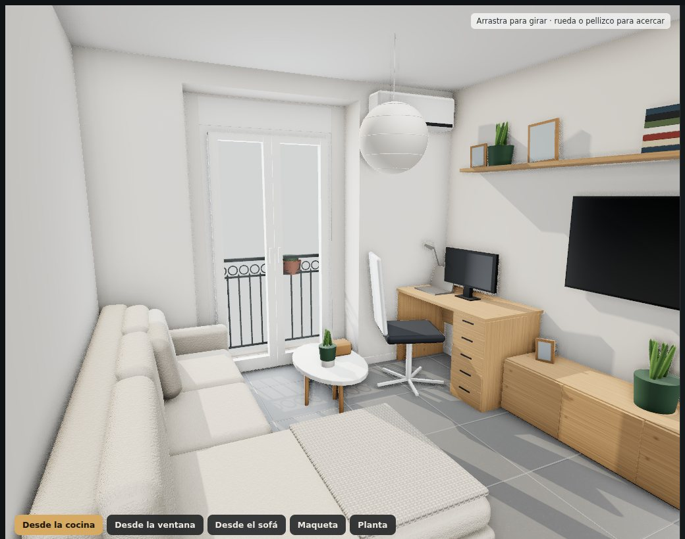
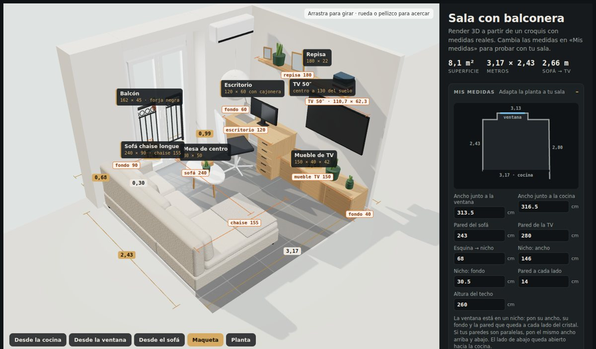
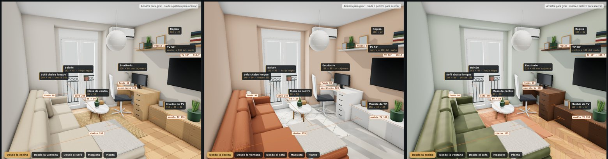
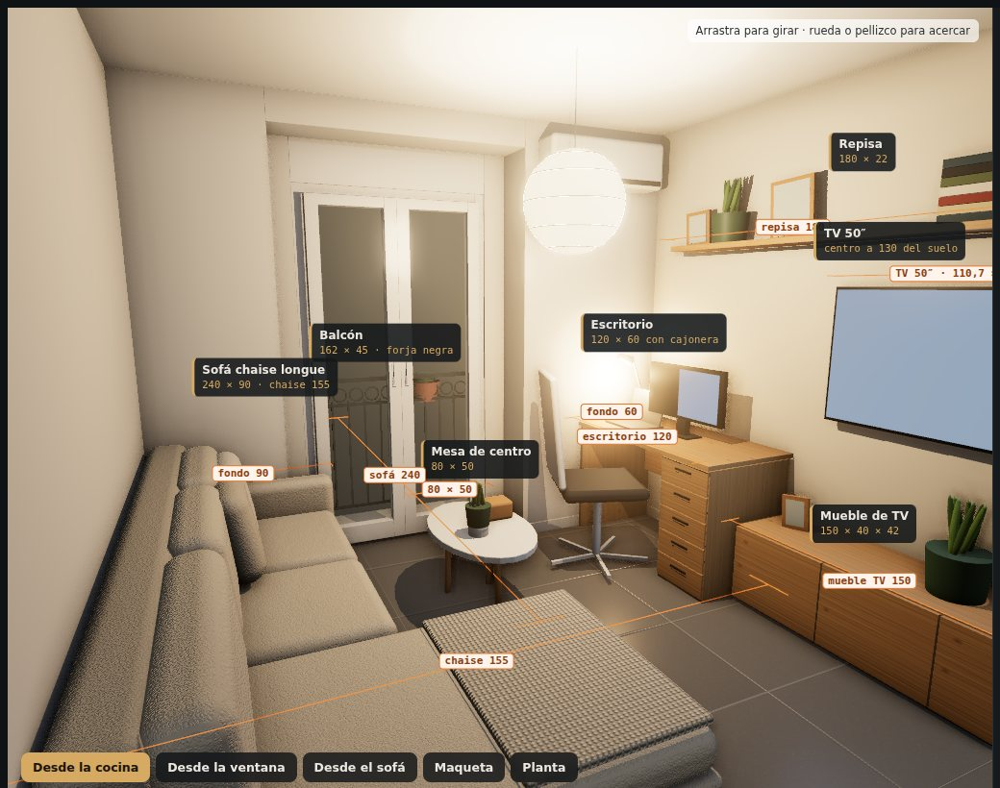
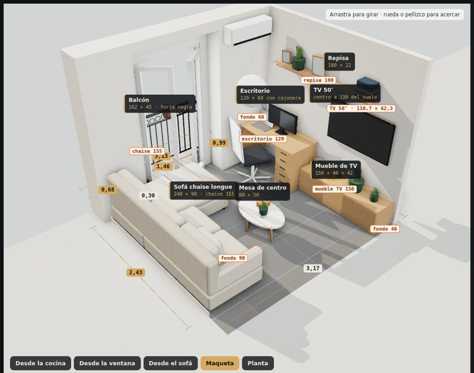
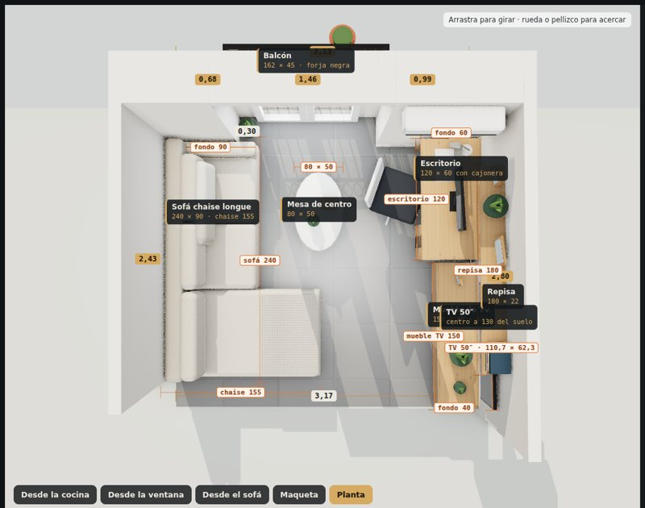

# Sala 3D

[](https://github.com/RicardoEdreiraPenas/sala-3d/actions/workflows/pages.yml)

Después de la [cocina](https://github.com/RicardoEdreiraPenas/cocina-3d) le tocó a la sala. Es pequeña, de unos 3,17 × 2,43 m, con una balconera al fondo de un nicho y el otro lado abierto a la cocina. Quería saber si cabía un sofá con chaise sin que sobresaliera de su pared, a qué distancia quedaba la tele y si la balconera seguía abriendo con los muebles puestos. Así que dibujé el croquis con las medidas y lo pasé a 3D.

Funciona en el navegador y cualquiera puede meter las medidas de su sala.

Puedes probarlo aquí: https://ricardoedreirapenas.github.io/sala-3d/



## Qué hace

- Parte de mi sala: pared del sofá de 2,43, pared de la TV de 2,80 y 3,135 de ancho junto a la ventana (68 + 146 + 99,5). La ventana es una balconera de dos hojas al fondo de un nicho de 30,5 cm, con 14 cm de pared a cada lado, y da a un balcón pequeño de los de asomarse, con barandilla de forja negra. Junto a la cocina la sala mide 3,165, así que la pared de la TV se abre un poco, y el modelo lo respeta.
- Tiene dos distribuciones:
  - **A · Como la tengo:** sofá con la chaise hacia la cocina, escritorio en la esquina de la ventana, mueble bajo con la TV colgada encima y una repisa larga por arriba.
  - **B · Chaise a la ventana:** la chaise mira a la luz. Queda bonito, pero el panel avisa de que las hojas de la balconera chocan con ella.
- En «Mis medidas» cambias las paredes, el nicho de la ventana, el techo y las medidas de los muebles: sofá, chaise, escritorio, mueble de TV, pulgadas de la TV, repisa y mesa de centro. Un plano pequeño se va dibujando mientras escribes.

  

- Cada mueble lleva sus cotas en naranja dentro del 3D. Se ocultan con «Medidas de muebles».
- El panel comprueba lo que me importaba:
  - que el sofá no sobresalga de su pared,
  - la distancia del sofá a la TV y qué pulgadas van bien a esa distancia,
  - la altura de la pantalla y el hueco hasta la repisa,
  - el paso junto a la chaise y la distancia a la mesa de centro,
  - cuántos grados abre cada hoja de la balconera antes de tocar un mueble,
  - el sitio para la silla del escritorio y la luz natural.
- Hay 4 opciones de moda en cada acabado y 4 estilos que se aplican con un clic.

  | Categoría | Opciones |
  |---|---|
  | Tapicería del sofá | Bouclé crudo · Lino arena · Terciopelo oliva · Pana terracota |
  | Muebles | Roble claro · Nogal · Lacado blanco · Grafito mate |
  | Pintura de pared | Blanco cálido · Greige · Arcilla · Verde niebla |
  | Suelo | Porcelánico gris 60×60 · Roble en espiga · Tarima de roble · Microcemento |
  | Alfombra | Sin alfombra · Yute · Bereber crema · Lisa terracota |

  

- De día entra el sol por la balconera. De noche se encienden la lámpara de papel, el flexo del escritorio y la TV.

  

- Tiene cinco vistas: desde la cocina (el mismo sitio desde donde hice la foto), desde la ventana, desde el sofá, maqueta y planta.
- El diseño se guarda en la URL y el enlace se puede pasar a quien quieras. Por ejemplo `#A.00000`. Si cambias medidas, van dentro: `.m` con las de la sala y `.f` con las de los muebles, en milímetros (la TV en pulgadas).
- «Guardar imagen» descarga la vista en PNG a unos 2400 px de ancho, con las medidas y etiquetas que estés viendo. Es lo que le paso a quien me monta los muebles.

| Chaise a la ventana | Planta |
|---|---|
|  |  |

## Cómo usarlo en tu ordenador

No hace falta instalar nada. Three.js va dentro de `vendor/`, así que funciona sin internet. Solo necesitas servir la carpeta:

```bash
python3 -m http.server 8000
# abre http://localhost:8000
```

Si prefieres un único archivo HTML para compartir:

```bash
python3 scripts/build_single.py   # crea dist/sala-3d.html
```

## Cómo adaptarlo

- [`js/config.js`](js/config.js) tiene las medidas de partida de la sala (`DEFAULT_ROOM`), las de los muebles (`DEFAULT_FURNITURE`), las alturas fijas, el catálogo de acabados y los estilos.
- La escena se monta en [`js/main.js`](js/main.js): `buildRoom()` hace las paredes, el nicho y la balconera, y `buildLayout()` coloca los muebles de cada distribución. Los muebles de la pared de la TV van en un grupo girado, porque esa pared no es del todo paralela.
- Los textos del panel salen de [`js/info.js`](js/info.js) y se calculan con las medidas.
- Las texturas (bouclé, lino, pana, yute, tarima…) se dibujan en canvas en [`js/textures.js`](js/textures.js). No hay imágenes externas.

## Pruebas

Cada cambio que subo pasa por una prueba en Chromium sin ventana (`tests/smoke.mjs`). Carga la web, dibuja las dos distribuciones, los cuatro estilos y las cinco vistas, cambia medidas, guarda una imagen y abre un enlace compartido. Si algo falla, GitHub Actions no publica.

```bash
npm install && npx playwright install chromium
python3 -m http.server 8000 &
npm test
```

## Licencia

MIT. Úsalo, cámbialo y compártelo como quieras.
